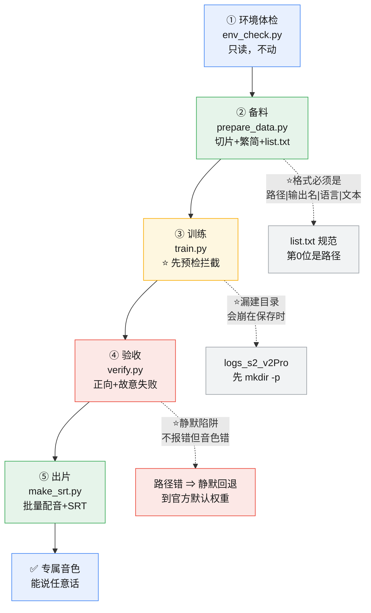

# local-tts-suite · 架构

> 技能封装规约产物 · 2026-11-08
> 配套 `SKILL.md`。渲染工具：`local-asset-cleanup/scripts/render_architecture.py`

---

## 结构说明

本 skill 是**一条五步流水线**，从"环境体检"到"出片+字幕"，单向流动。

| 块 | 干什么 | 产出 |
|---|---|---|
| **① 环境体检** `env_check.py` | 显卡/CUDA/仓库结构/底模/数据/换行 | 可执行性报告（**只读**） |
| **② 备料** `prepare_data.py` | 静音检测切片 + 繁简统一 + 生成 `list.txt` | `data/<exp>/wavs/` + `list.txt` |
| **③ 训练** `train.py` | ⭐**预检拦截 → s1/s2 两阶段训练** | `GPT_weights_v2Pro/*.ckpt` + `SoVITS_weights_v2Pro/*.pth` |
| **④ 验收** `verify.py` | 正向生成 + ⭐**故意制造失败** | 验收报告（JSON） |
| **⑤ 出片** `make_srt.py` | 批量配音 + SRT 字幕 | wav + `.srt` |

⭐ **两个"反直觉"的设计，是本 skill 的真正价值所在**：

- **③ 训练前先预检** —— 训练一次几小时，不能因为低级错白跑
- **④ 验收含故意制造失败** —— "能出声音"不等于"配置对"，很多错是**静默**的

---

## mermaid 源码

---

## 坑位表（图上标 ⭐ 处）

| # | 坑 | 对策 | 拦在哪一步 |
|---|---|---|---|
| ⭐ 1 | **list.txt 字段顺序** —— 第 0 位是路径，不是输出名 | `prepare_data.py` 按规范生成；`train.py` 预检逐行校验 | ②③ |
| ⭐ 2 | **`logs_s2_v2Pro` 漏建** —— 官方 webui 会建，直接调脚本会绕过 | `train.py` 预检拦截并提示 `mkdir -p` | ③ |
| ⭐ 3 | **静默回退** —— 路径错/没包 `custom` ⇒ 加载官方默认权重，不报错 | `verify.py` 用**错路径**加载，反证能否发现回退 | ④ |
| 4 | 词表版本（v2Pro 必须 732 词表 `s1v3.ckpt`） | `env_check.py` 检查底模 | ① |
| 5 | 参考音频 3~10 秒硬限制 | `verify.py` + `train.py` 都查切片时长 | ①④ |
| 6 | Windows PATH 用 `;` 不是 `:` | 脚本内统一修正 | 全程 |
| 7 | `sys.path` 要同时加仓库根与 `GPT_SoVITS/` | 脚本内统一注入 | 全程 |
| 8 | `.bat` 必须 CRLF | `env_check.py` 检查换行 | ① |
| 9 | 并行下载与并行装互相绊倒 | 下载到临时目录再合并 | 安装期 |

---

## 边界

| 做 | 不做 |
|---|---|
| 探测环境、备料、训练、验收、出片 | ❌ 决定用什么音色/什么语气（那是人） |
| 校验配置是否真的生效 | ❌ 判断"好不好听"（耳朵的事） |
| 拦截已知的低级错 | ❌ 替你踩没见过的坑 |
| 只用官方开源项目 | ❌ 打包模型权重（几十 GB，且多为他人成果） |

⭐ 与 `workspace-tidy` 的分工：本 skill 管**音色流水线**，
`workspace-tidy` 管**工作空间整理**。两者不重叠。
